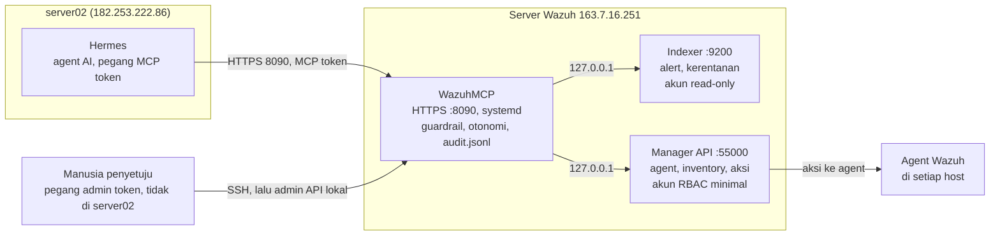
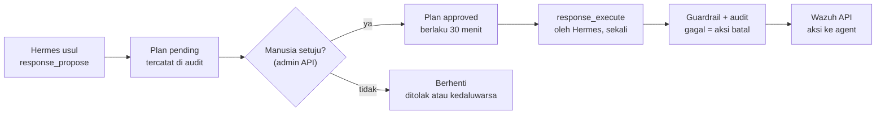

# WazuhMCP: tools, kewenangan, dan akses agent

Per 19 November 2026, paket `wazuhmcp-0420e01`.

## Ringkasan

WazuhMCP adalah server MCP (Model Context Protocol) yang memberi agent AI akses baca ke Wazuh 4.14 dan jalur respons yang dikendalikan manusia. Di produksi, satu-satunya agent AI yang terhubung adalah **Hermes** di server02.

- **Lokasi:** server Wazuh produksi 163.7.16.251, dipasang sebagai service systemd (user sistem `wazuhmcp`, tanpa root).
- **Paket:** `wazuhmcp-0420e01-linux-amd64.tar.gz` (commit `0420e01`).
- **Masuk:** HTTPS port 8090, hanya dari server02 (182.253.222.86).
- **Keluar:** Wazuh Manager API (port 55000) dan Wazuh Indexer (port 9200), keduanya lewat `127.0.0.1` di host yang sama.
- **Batas kewenangan:** AI hanya bisa membaca data dan mengusulkan aksi. Aksi yang mengubah sistem (blokir IP, restart agent, scan FIM) hanya berjalan setelah disetujui manusia.



Firewall hanya membuka port 8090 untuk server02; port 55000 dan 9200 cukup diakses WazuhMCP dari host yang sama.

## Siapa yang boleh mengakses

Akses ke WazuhMCP ditentukan oleh dua token yang terpisah, plus firewall yang hanya membuka port 8090 untuk server02. Pihak yang memegang token AI tidak bisa menyetujui aksi.

| Pihak | Kredensial | Endpoint | Boleh melakukan | Tidak boleh |
| --- | --- | --- | --- | --- |
| **Hermes** (agent AI di server02) | MCP token (`WAZUHMCP_TOKEN`) | `https://163.7.16.251:8090/mcp` | Memanggil tool baca dan investigasi, membuat usulan aksi, mengeksekusi aksi yang **sudah disetujui** manusia | Menyetujui atau menolak usulan, mengubah level otonomi atau guardrail |
| **Manusia penyetuju** (tim keamanan) | Admin token (`WAZUHMCP_ADMIN_TOKEN`) | `https://163.7.16.251:8090/admin/...`, dijalankan dari server Wazuh lewat SSH | Melihat, menyetujui, menolak, dan mengeksekusi usulan; melihat blokir aktif | — |
| **Pengelola server Wazuh** | Akses root ke server | `/etc/wazuhmcp/wazuhmcp.env`, systemd | Mengatur token, level otonomi, guardrail, dan akun Wazuh | — |
| Agent atau host lain | — | — | Tidak ada: port 8090 ditutup firewall, dan request tanpa token valid ditolak | Semua |

Aturan pemakaian token:

- MCP token dan admin token wajib berbeda; server menolak start kalau keduanya sama.
- Admin token tidak boleh disimpan di konfigurasi Hermes atau host mana pun yang bisa dibaca agent AI.
- Menambah agent AI lain (misalnya untuk staging) berarti memberinya MCP token yang sama dan membuka firewall untuk IP-nya. Saat ini hanya ada satu MCP token, jadi semua agent yang memegangnya punya hak yang sama, dan log tidak membedakan agent mana yang memanggil.

## Daftar tool dan yang dipanggil di Wazuh

WazuhMCP menyediakan 17 tool dan 1 prompt. Dari semuanya, hanya `response_execute` yang mengubah sistem; tool lain hanya membaca atau mencatat usulan di memori WazuhMCP. Query ke Indexer dibangun dari parameter bertipe, jadi AI tidak pernah mengirim query mentah, dan hanya dua pola indeks yang boleh dibaca.

| Tool | Fungsi | Memanggil di Wazuh | Sifat | Tersedia mulai level |
| --- | --- | --- | --- | --- |
| `health` | Cek koneksi, versi, jumlah agent per status | API `GET /`, `GET /agents/summary/status`; Indexer `wazuh-alerts-4.x-*` (size 0) | Baca | readonly |
| `agents_list` | Daftar agent: status, IP, OS, versi, grup | API `GET /agents` | Baca | readonly |
| `agent_packages` | Paket terpasang di satu agent | API `GET /syscollector/{id}/packages` | Baca | readonly |
| `alerts_summary` | Top rule, agent, IP sumber, MITRE, level, aktivitas per waktu | Indexer `wazuh-alerts-4.x-*` | Baca | readonly |
| `alerts_search` | Cari alert per IP, agent, grup, rule, MITRE, level, rentang waktu | Indexer `wazuh-alerts-4.x-*` | Baca | readonly |
| `alert_get` | Detail satu alert, termasuk log mentah (dipotong) | Indexer `wazuh-alerts-4.x-*` | Baca | readonly |
| `alerts_timeline` | Alert urut dari yang terlama, berhalaman | Indexer `wazuh-alerts-4.x-*` | Baca | readonly |
| `attacker_profile` | Semua yang dilakukan satu IP sumber, termasuk login berhasil dan pergerakan lateral | Indexer `wazuh-alerts-4.x-*`; API `GET /agents` | Baca | readonly |
| `host_triage` | Tanda host disusupi: proses, port, akun, login, file persistensi, CVE | API `GET /agents`, `GET /syscollector/{id}/processes`, `/ports`, `/users`; Indexer alert dan kerentanan | Baca | readonly |
| `vulns_summary` | Kerentanan per severity, agent, paket, CVE | Indexer `wazuh-states-vulnerabilities-*` | Baca | readonly |
| `vulns_search` | Daftar temuan kerentanan, CVSS tertinggi dulu | Indexer `wazuh-states-vulnerabilities-*` | Baca | readonly |
| `mitigation_options` | Opsi mitigasi untuk satu alert atau CVE | Indexer alert atau kerentanan | Baca | readonly |
| `autonomy_status` | Aksi apa yang boleh dilakukan AI dan di level apa | Tidak ada (konfigurasi lokal) | Baca | readonly |
| `response_propose` | Membuat usulan aksi (plan) dengan alasan | Tidak ada; plan disimpan di memori WazuhMCP dan dicatat di audit log | Usulan | propose |
| `response_plans` | Melihat usulan dan statusnya | Tidak ada | Baca | propose |
| `blocks_list` | Blokir IP yang masih aktif | Tidak ada (catatan WazuhMCP) | Baca | propose |
| `response_execute` | Menjalankan usulan yang sudah disetujui | API `PUT /active-response` (`block_ip`), `PUT /agents/restart` (`restart_agent`), `PUT /syscheck` (`scan_fim`) | **Mengubah sistem** | approve |
| Prompt `investigate_incident` | Permintaan investigasi siap pakai yang menghasilkan laporan | Tidak ada (teks); memakai tool di atas | — | readonly |

Tiga aksi yang bisa dijalankan `response_execute`:

- **`block_ip`**: memblokir satu IP di agent yang dipilih lewat active response `firewall-drop`, selama 300 atau 3600 detik. Wazuh melepas blokir sendiri saat waktunya habis; API Wazuh tidak punya cara melepas lebih awal.
- **`restart_agent`**: me-restart service agent Wazuh (pemantauan berhenti sekitar 30 detik).
- **`scan_fim`**: memulai pemindaian integritas file (FIM) di agent.

## Kewenangan akun Wazuh

WazuhMCP memakai dua akun least-privilege bernama `wazuhmcp`, satu di Wazuh API dan satu di Indexer, dibuat pengelola Wazuh dengan skrip `create-wazuhmcp-users.sh` dari paket. Izin di bawah ini sudah teruji cukup untuk semua tool (lab Wazuh 4.14.9, 18 November 2026).

| Akun | Izin | Resource | Dipakai oleh |
| --- | --- | --- | --- |
| Indexer | `read` | `wazuh-alerts-4.x-*` | Semua tool alert, investigasi, `mitigation_options`, `health` |
| Indexer | `read` | `wazuh-states-vulnerabilities-*` | `vulns_*`, `host_triage`, `mitigation_options` |
| Indexer | `cluster_composite_ops_ro` | cluster | Pencarian lintas indeks |
| API | `agent:read` | `agent:id:*` | `agents_list`, `health`, `attacker_profile`, `host_triage` |
| API | `syscollector:read` | `agent:id:*` | `agent_packages`, `host_triage` |
| API | `active-response:command` | `agent:id:*` | `response_execute` untuk `block_ip` |
| API | `agent:restart` | `agent:id:*` | `response_execute` untuk `restart_agent` |
| API | `syscheck:run` | `agent:id:*` | `response_execute` untuk `scan_fim` |

Izin yang **sengaja tidak diberikan**:

- **`manager:read`**: membuka `/manager/configuration`, yaitu seluruh `ossec.conf` termasuk secret integrasi. `health` memakai `GET /` yang tidak butuh izin ini.
- **`syscheck:read`**: tidak diperlukan; perubahan file dibaca dari alert FIM di Indexer.
- **Akun `admin` dan `wazuh-wui`**: jangan dipakai untuk WazuhMCP.
- **Indeks lain** (archives, inventory, monitoring): tidak dibaca. Daftar indeks dikunci di kode, bukan di konfigurasi.

Kalau mode `readonly` yang dipakai, tiga izin respons di API (`active-response:command`, `agent:restart`, `syscheck:run`) boleh tidak diberikan.

## Kewenangan AI: level otonomi

Produksi memakai level **`approve`**: Hermes boleh mengusulkan aksi dan menjalankannya hanya setelah manusia menyetujui lewat admin API. Level diatur pengelola server di `/etc/wazuhmcp/wazuhmcp.env` (`WAZUHMCP_AUTONOMY`, dan per aksi lewat `WAZUHMCP_AUTONOMY_ACTIONS`); Hermes tidak bisa mengubahnya.

| Level | Hermes boleh | Peran manusia | Tool respons yang terlihat |
| --- | --- | --- | --- |
| `readonly` | Hanya membaca | — | Tidak ada |
| `propose` | Membuat usulan | Menyetujui dan mengeksekusi lewat admin API (`POST /admin/plans/<id>/execute`) | `response_propose`, `response_plans`, `blocks_list` |
| **`approve`** (produksi) | Membuat usulan, mengeksekusi usulan yang **sudah disetujui** | Menyetujui atau menolak | Ditambah `response_execute` |
| `auto` | Membuat dan mengeksekusi sendiri | Memantau audit log | Sama dengan `approve` |

Tool yang tidak boleh dipakai pada level yang berlaku tidak didaftarkan sama sekali, jadi Hermes tidak melihatnya. Level bisa diatur per aksi, misalnya `scan_fim=auto` sementara `block_ip` tetap `approve`.



Guardrail dan audit diperiksa ulang tepat sebelum aksi dikirim, jadi usulan yang sudah disetujui tetap ditolak bila melanggar batas atau audit gagal ditulis.

Perintah admin API untuk manusia penyetuju dijalankan **di server Wazuh itu sendiri** (lewat SSH), bukan dari server02: firewall hanya membuka port 8090 untuk server02, dan admin token tidak boleh berada di host yang sama dengan Hermes.

```sh
A="Authorization: Bearer <admin token>"
U=https://163.7.16.251:8090/admin
curl --cacert tls.crt -H "$A" "$U/plans?status=pending"
curl --cacert tls.crt -H "$A" -X POST "$U/plans/<id>/approve"
curl --cacert tls.crt -H "$A" -X POST "$U/plans/<id>/reject"
curl --cacert tls.crt -H "$A" "$U/blocks"
```

## Guardrail dan audit

Guardrail berlaku di semua level otonomi, termasuk `auto`, dan tidak bisa diubah lewat tool MCP; hanya pengelola server yang bisa mengubahnya di file env.

| Guardrail | Nilai di produksi | Pengaturan |
| --- | --- | --- |
| IP yang tidak boleh diblokir | 182.253.222.86 (server02) dan 163.7.16.251 (server Wazuh sendiri: blokir IP manager memutus agent darinya), ditambah IP admin/VPN tim keamanan | `WAZUHMCP_PROTECTED_IPS` |
| Agent yang tidak boleh disentuh | `000` (manager) selalu, ditambah daftar lain | `WAZUHMCP_PROTECTED_AGENTS` |
| Agent per usulan | Maks 5 | `WAZUHMCP_MAX_AGENTS` |
| Eksekusi per aksi per jam | Maks 10 | `WAZUHMCP_MAX_PER_HOUR` |
| Masa berlaku usulan | 30 menit, hanya bisa dijalankan sekali | `WAZUHMCP_PLAN_TTL` |
| Durasi blokir | Hanya 300 atau 3600 detik | `WAZUHMCP_BLOCK_COMMANDS` |
| Skrip active response custom | Ditolak (nama berawalan `!`) | Di kode, tidak bisa diubah |
| Hasil per panggilan | Maks 50 alert atau temuan; 100 per halaman timeline | Di kode |

Audit log:

- Lokasi `/var/lib/wazuhmcp/audit.jsonl` (mode 0600), satu baris JSON per kejadian: usulan, persetujuan, penolakan, awal eksekusi, hasil, termasuk eksekusi yang ditolak.
- Audit ditulis **sebelum** aksi dikirim ke Wazuh. Kalau gagal ditulis, aksi dibatalkan.
- Usulan disimpan di memori dan hilang saat service restart (disengaja); audit log tetap ada.
- Log aktivitas tool (`tool: <nama> ✓`) masuk ke journald: `journalctl -u wazuhmcp`.

Data dari Wazuh dianggap **tidak tepercaya**: isi alert dan log bisa ditulis penyerang dan berisi teks yang menyerupai perintah. WazuhMCP membuang karakter kontrol, memotong teks panjang, dan menginstruksikan Hermes untuk tidak mengikuti perintah di dalam data. Ini mengurangi risiko prompt injection, tapi tidak menghilangkannya; karena itu aksi tetap butuh persetujuan manusia.

## Menghubungkan Hermes

Hermes tersambung lewat entri `mcp_servers` di `config.yaml`-nya, memakai MCP token dan sertifikat HTTPS WazuhMCP ([referensi konfigurasi MCP Hermes](https://github.com/nousresearch/hermes-agent/blob/main/website/docs/reference/mcp-config-reference.md)).

```yaml
mcp_servers:
  wazuh:
    url: "https://163.7.16.251:8090/mcp"
    headers:
      Authorization: "Bearer <MCP token>"     # WAZUHMCP_TOKEN, bukan admin token
    ssl_verify: "/etc/hermes/wazuhmcp-tls.crt" # salinan /etc/wazuhmcp/tls.crt dari server Wazuh
    timeout: 120
    tools:
      prompts: true                            # prompt investigate_incident
```

1. Pengelola server Wazuh mengirim `/etc/wazuhmcp/tls.crt` (publik, bukan rahasia) dan MCP token (rahasia, lewat kanal aman) ke pengelola server02.
2. Simpan sertifikat di server02 dan isi `ssl_verify` dengan path-nya. Jangan pakai `ssl_verify: false`.
3. Simpan MCP token sebagai secret Hermes, jangan di repo atau file yang ikut di-commit.
4. Restart Hermes setelah WazuhMCP berjalan, lalu tanyakan sesuatu yang memanggil tool, misalnya "Cek kesehatan Wazuh."
5. Pastikan di server Wazuh: `journalctl -u wazuhmcp -f` menampilkan `tool: health ✓`. Jawaban Hermes tanpa baris itu berarti tidak berasal dari Wazuh.

Opsional, sebagai lapisan pengaman tambahan di sisi Hermes: `tools.exclude: [response_execute]` membuat Hermes tidak bisa menjalankan aksi sama sekali, sementara usulan tetap bisa dibuat dan dieksekusi manusia lewat admin API.

Pelajaran dari lab (klien ZeroClaw): klien memuat daftar tool saat start. Kalau Hermes start ketika WazuhMCP mati, tool Wazuh bisa tidak terdaftar sampai Hermes di-restart. Urutan yang aman: WazuhMCP dulu, lalu Hermes.

## Batasan dan yang belum diuji

Semua uji dilakukan di lab Wazuh 4.14.9 dengan akun least-privilege; belum ada yang dijalankan di Wazuh produksi.

Yang tidak bisa dilihat WazuhMCP, karena datanya tidak ada di Wazuh:

- Host tanpa agent Wazuh.
- Aktivitas yang tidak memicu rule, misalnya membaca file sensitif tanpa auditd atau who-data.
- Pemindaian jaringan, kecuali log firewall atau IDS dikirim ke Wazuh.
- Data yang lebih tua dari masa simpan Indexer.
- Inventory (proses, port, akun) adalah hasil scan syscollector terakhir, bukan kondisi saat ini; penyerang dengan akses root bisa menyembunyikan proses.

Belum diuji:

- Unit systemd di server produksi (sandbox systemd belum pernah dijalankan).
- Koneksi Hermes ke WazuhMCP.
- Mode `auto` untuk `block_ip` dan `restart_agent`.
- Pergerakan lateral antar dua agent sungguhan (baru unit test).

Belum ada: UI untuk antrean persetujuan (sementara lewat curl ke admin API), alert realtime, dan aksi isolasi host. Satu MCP token dipakai bersama, jadi log belum bisa membedakan agent mana yang memanggil.
